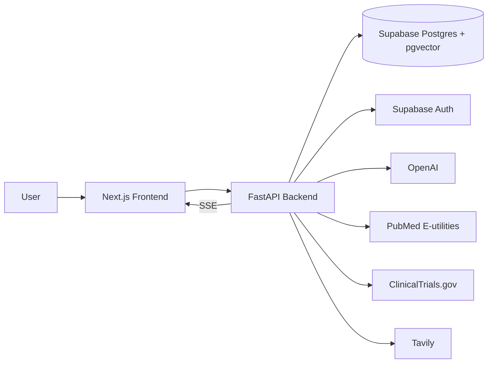

# Clinical Evidence Intelligence

> "Understand the evidence. Not just the answer."

An AI-powered evidence intelligence platform for exploring medical literature,
comparing studies, and understanding where evidence agrees — or conflicts.

**This is a research tool. It does not diagnose, prescribe, or replace a
clinician's judgment.** See [Medical Safety](#medical-safety) below.

---

## Build Status

This repo is being built in phases (matches the original spec). Do not assume
anything below "IN PROGRESS" works end-to-end yet.

| Phase | Scope | Status |
|---|---|---|
| 1 | Project setup, DB schema, FastAPI + Next.js skeleton, Supabase auth wiring | Done |
| 2 | Research creation + Query Analyzer agent | Done |
| 3 | PubMed / ClinicalTrials.gov / Tavily integrations, normalization, dedup | Done |
| 4 | Study Analysis Agent: structured extraction, findings, relevance scoring | Done |
| 5 | Evidence Verification, Conflict Detection, Evidence Grading | Done |
| 6 | RAG + pgvector + Ask This Paper | Done |
| 7 | Research Report, citations, Evidence Map, study detail, bookmarks | Done |
| 8 | Real-time SSE pipeline | Done |
| 9 | Testing + security hardening | Done |
| 10 | Polish, responsive, accessibility, deploy | **Done (this commit)** |

### What Phase 9 actually does

**Security hardening:**
1. **Rate limiting** (`app/core/rate_limit.py`) — an in-process sliding-window
   limiter (same single-instance design rationale as the Phase 8 event bus)
   applied per-user to the genuinely expensive endpoints: `POST /start`
   (10/min), `POST /index` (10/min), `POST /studies/{id}/ask` (20/min).
   Returns `429` with a real `Retry-After` header.
2. **Request body size limit** — requests over 1MB are rejected with `413`
   before the body is read, via `app/core/max_body_size.py`.
3. **Security response headers** — `X-Content-Type-Options`,
   `X-Frame-Options`, `Referrer-Policy`, `Permissions-Policy` on every
   response via `app/core/security_headers.py`.
4. **Pagination** — `GET /api/research` and `GET /api/research/{id}/studies`
   now take `limit`/`offset` query params (capped at 100/200 respectively)
   instead of returning an unbounded list.
5. **Security audit performed**: grepped for f-string-interpolated SQL
   (none found — every query goes through the ORM or parameterized
   `text()`), and for any logging statement that might leak
   `OPENAI_API_KEY`/`SUPABASE_SERVICE_KEY`/similar (none found).

**Testing:**
1. **Frontend test suite added from scratch** — Vitest + React Testing
   Library were scaffolded in Phase 1 but never actually used until now.
   17 real component tests across `AskPaperPanel`, `ResearchReport`,
   `EvidenceMap`, and the landing page, run via the real `npm run test`
   command. One of these tests caught a genuine ambiguous-text-match bug
   in the excerpt-vs-answer rendering during development.
2. **AI safety evaluation harness** (`backend/evals/`) — a small dataset of
   scripted scenarios (`eval_dataset.py`) run through the *real* production
   agents (`run_evals.py`), checking: excerpt-grounding correctness
   (including that a fabricated citation is actually rejected),
   conflict-detection accuracy against the full BENEFIT/HARM/NO_EFFECT/
   UNCLEAR rule table, and structured-output schema validity. Runnable
   standalone (`python -m evals.run_evals`, prints a pass/fail report) and
   wired into the normal test suite (`tests/test_ai_evals.py`) so a
   regression in any of these safety mechanisms fails CI.
3. **Backend test count: 155**, all passing against a from-scratch
   database built purely from the four committed migration files.

**A real bug found and fixed along the way**: the security-hardening test
for rate limiting on `/start` originally left several unmocked background
pipeline tasks dangling past test teardown, printing `RuntimeError: no
running event loop` noise (harmless, but a real test-hygiene issue) —
fixed by mocking the pipeline's LLM/embedding clients in that test file too
and giving dispatched background tasks a moment to finish before the event
loop closes.

### What Phase 8 actually does

1. **`POST /api/research/{id}/start` no longer blocks.** It creates the job
   row and dispatches the entire pipeline (`app/services/pipeline_service.py`)
   as a background `asyncio` task, returning immediately with `202
   Accepted` and status `RUNNING`. The full stage sequence — Query
   Analyzer → PubMed/ClinicalTrials.gov/Tavily → Document Indexing → Study
   Analysis → Evidence Verification → Conflict Detection → Evidence
   Grading → Report Generation — is unchanged from Phases 2–7; it just now
   runs after the response, not before it.
2. **`GET /api/research/{id}/events`** — a real Server-Sent Events stream.
   Every event corresponds to something that actually just happened in the
   pipeline (`agent_started`/`agent_completed`/`agent_failed` for each of
   the ten named stages, `study_found` with real per-origin counts,
   `conflict_found` once per actual detected conflict, `report_ready`, and
   a final `pipeline_completed` carrying the job's real terminal status).
   Nothing here is a timer-based fake progress tick — verified directly by
   a test that asserts real stage ordering (Query Analyzer's
   `agent_started` genuinely precedes PubMed's).
3. **`GET /api/research/{id}/job`** — a new small endpoint returning the
   latest job's full detail (status, evidence_grade, failure_summary),
   needed now that `/start`'s response is no longer the final result. A
   frontend polls this (or just watches the SSE stream) to know when the
   pipeline is done.
4. **In-process event bus** (`app/core/event_bus.py`) — one `asyncio.Queue`
   per subscriber, keyed by `research_job_id`, with a bounded history
   buffer so a client connecting slightly after `/start` returns still
   gets replayed the events it missed. Deliberately not Redis or a message
   queue: this is a single-process deployment target, and that's the
   right amount of infrastructure for it.
5. **Resilience carried through**: a genuinely broken pipeline can never
   leave a job stuck in `RUNNING` forever — the background task has a
   top-level exception handler that marks the job `FAILED` with a real
   error message and still emits `pipeline_completed` so any listening
   client's stream ends cleanly.
6. **Frontend**: `components/research/ResearchProgress.tsx` — a real
   component that opens an authenticated `fetch` stream (not the bare
   `EventSource` API, since that can't send the Supabase bearer token) and
   parses the SSE frames itself, updating each of the ten pipeline stages
   live as real events arrive. No mocked progress bar anywhere.

**Existing tests updated, not weakened**: every test that used to call
`/start` and assert on the result synchronously now polls
`GET /api/research/{id}/job` until a terminal status is reached (via a
shared `tests/pipeline_test_utils.py` helper) — the same way a real client
has to, since the endpoint's contract genuinely changed.

### What Phase 7 actually does

1. **Report Generation** — the LLM's role is deliberately narrow: it only
   writes prose (executive summary, key findings, evidence gaps,
   limitations, conclusion) from a list of claims **already verified as
   SUPPORTED/PARTIALLY_SUPPORTED in Phase 5** — never claims that weren't
   already checked against source text. Every other section (methodology,
   studies analyzed, high-quality evidence, conflicting evidence, sources)
   is assembled directly from database rows with no LLM involvement.
2. **Citations are never LLM-assigned.** Citation numbers are computed in
   code (`app/services/report_generation_service.py`), one per verified
   claim in creation order, *before* the LLM is even called — the LLM is
   handed those exact numbers to reference in prose and cannot invent a
   new one or point to something that doesn't exist. Verified directly by
   a test where an unsupported claim is deliberately mixed in and confirmed
   to receive **no** citation number.
3. **Evidence Map** (`GET /api/research/{id}/evidence-map`) — also fully
   deterministic. The research question is the center node; each study is
   a node carrying its dominant effect direction (or `UNCLEAR` if a
   study's own findings disagree with each other); conflicting study pairs
   get a distinguishable `conflict`-type edge. No LLM involved.
4. **Study Detail** (`GET /api/studies/{id}`) — the plain single-study
   fetch that earlier phases' API design always anticipated but never
   implemented; surfaces authors/DOI from the source's retrieved metadata.
5. **Bookmarks** — `POST`/`DELETE /api/studies/{id}/save` and
   `POST /api/reports/{id}/save`, both idempotent (saving twice is a no-op,
   not an error or a duplicate row).
6. Report generation runs automatically as the final pipeline stage in
   `/start`; failing here never fails the whole job (a research run with
   useful evidence but no generated report is still a successful run) —
   it's also available on demand via `POST /api/research/{id}/report`.
7. **Frontend**: `components/research/ResearchReport.tsx` (editorial,
   scientific-publication-style rendering with clickable `[n]` citations
   jumping to the sources list) and `components/research/EvidenceMap.tsx`
   (question-centered, studies color-coded by effect direction with
   conflict badges — a real, working data visualization, not a mocked
   graph library). Both fetch real data from the endpoints above; no mock
   content anywhere. A full interactive force-directed graph and PDF export
   remain out of scope for this phase.

**New endpoints**: `GET`/`POST /api/research/{id}/report`, `GET /api/research/{id}/evidence-map`,
`GET /api/studies/{id}`, `POST`/`DELETE /api/studies/{id}/save`, `GET /api/reports/{id}`,
`POST`/`DELETE /api/reports/{id}/save`.

**No new migration was needed** — `research_reports`, `saved_studies`, and
`saved_reports` already existed in `0001_init.sql`.

### What Phase 5 actually does

After Phase 4 analyzes each study, `POST /api/research/{id}/start` also:

1. **Claim Extraction** — an LLM agent pulls up to 5 evidence-based claims
   per study (outcomes, findings, effect directions/sizes, conclusions) from
   that study's own Phase 4 analysis. Never extracts claims from metadata,
   and returns an empty list rather than inventing a claim when a study has
   no real content.
2. **Evidence Verification** — a second LLM agent checks each claim against
   *only* that study's retrieved document text, classifying it SUPPORTED /
   PARTIALLY_SUPPORTED / NOT_SUPPORTED / CONFLICTING. The model's claimed
   supporting excerpt is **programmatically checked** to be an actual
   (whitespace-normalized) substring of the real document text — if it
   isn't, the result is force-downgraded to NOT_SUPPORTED regardless of
   what the model said.
3. **Conflict Detection** — deliberately **not** an LLM call. Study
   findings are grouped by normalized outcome, and effect directions are
   compared via a fixed rule table (BENEFIT vs HARM = strong conflict,
   BENEFIT/HARM vs NO_EFFECT = conflict, anything involving UNCLEAR or same
   direction = no conflict). The "possible explanation" for a real conflict
   only ever cites an actually-observed metadata difference between the two
   studies — falling back to the literal
   *"Reason for disagreement not established from available evidence."*
   when nothing differs.
4. **Evidence Grading** — also deterministic. Computes source-quality,
   consistency (penalized by real conflicts, neutral rather than "perfect"
   with only one study), directness, and verified-claim-share subscores
   into a composite 0–1 score, mapped to
   STRONG/MODERATE/LIMITED/INSUFFICIENT with hard gates. The full subscore
   breakdown is stored as machine-readable JSON alongside the grade.

**Endpoints**: `GET /api/research/{id}/evidence`, `GET /api/research/{id}/conflicts`,
`GET /api/research/{id}/grade`, `GET /api/studies/{id}/evidence`.

**Schema note**: the grade is stored on `research_jobs` (migration `0003`), not
`research_reports` — that table's `sections`/`citations` columns are Phase 7's
responsibility and are `NOT NULL`, so writing a placeholder row there now would
mean starting Phase 7 early.

### What Phase 6 actually does

**Embedding model**: OpenAI `text-embedding-3-small`, 1536 dimensions — confirmed
(not assumed) to match the `vector(1536)` column already defined in
`0001_init.sql`. `EMBEDDING_DIMENSION` in `app/models/evidence.py` is the single
source of truth both the ORM column and `OpenAIEmbeddingClient`'s runtime
validation check against.

1. **Document metadata** — every `Document` now has a `document_type`
   (`ABSTRACT` / `TRIAL_SUMMARY` / `WEB_CONTENT` / `FULL_TEXT`), set at
   creation time in Phase 3's normalization based on origin. A PubMed
   abstract is never treated or displayed as a full paper.
2. **Chunking** (`app/rag/chunking.py`) — deterministic, word-boundary-safe,
   configurable size/overlap, merges any too-small trailing fragment into
   the previous chunk rather than keeping a meaningless sliver.
3. **Embeddings** (`app/integrations/embeddings.py`) — `EmbeddingClient`
   abstraction, `OpenAIEmbeddingClient` implementation. Every returned
   vector's length is checked against `EMBEDDING_DIMENSION` before it's
   ever handed back — a silent dimension mismatch fails loudly instead of
   corrupting the vector index.
4. **Indexing** (`app/services/rag_indexing_service.py`) — chunk → embed →
   store, per-document. Idempotent: always deletes existing chunks for a
   document before re-inserting, so indexing the same document twice never
   duplicates anything (also enforced at the DB level by a unique
   constraint on `(document_id, chunk_index)`). Runs automatically as part
   of `/start`, right after Phase 3 retrieval; also available on demand via
   `POST /api/research/{id}/index`.
5. **Retrieval** (`app/rag/rag_service.py`) — cosine similarity search via
   pgvector's `cosine_distance()`, hard-scoped to a single `study_id` at the
   SQL `WHERE` clause level, never just by prompt instruction. Below the
   similarity threshold, retrieval returns nothing and the LLM is never
   even called.
6. **Ask This Paper** (`POST /api/studies/{id}/ask`) — same grounding
   philosophy as Phase 5's evidence verification: the LLM proposes an
   answer and (if grounded) quotes an exact excerpt from one specific
   retrieved chunk, but that excerpt is checked programmatically against
   the real chunk text before being trusted. A fabricated or paraphrased
   quote gets the whole response downgraded to the fixed
   *"This paper does not provide enough information to answer that
   question."* — never a knowledge-fallback hallucination.
7. **Cross-study isolation** is enforced at the database query level, not
   just described in a prompt — verified directly by a test where Study A
   says "250 participants" and Study B says "500 participants," and asking
   Study A can never surface Study B's number.
8. **Frontend**: `components/studies/AskPaperPanel.tsx` — a real, working
   component (not mock data) built to the established editorial design
   system, showing the question input, answer, grounding badge, and quoted
   evidence excerpt with similarity score. Wired into a minimal
   `/studies/[id]` route; the full study detail page (fetching real title/
   metadata from the backend) is Phase 7 scope.

**New endpoints**: `POST /api/studies/{id}/ask`, `GET /api/studies/{id}/chunks`,
`POST /api/research/{id}/index` — all ownership-scoped the same way every other
endpoint is.

**Environment**: no new required variables — Phase 6 reuses `OPENAI_API_KEY`
(already required) for both completions and embeddings.

## Architecture



Agent pipeline:

```
QueryAnalyzer
   -> [PubMedAgent || ClinicalTrialsAgent || WebResearchAgent]
   -> Deduplication
   -> StudyAnalysisAgent
   -> EvidenceVerificationAgent
   -> ConflictDetectionAgent
   -> EvidenceGradingAgent
   -> ReportGenerationAgent
```

Every agent run is persisted as a row in `agent_runs` (status, input, output,
error, retry_count). Frontend progress reflects these rows via SSE — nothing
is a fake `setTimeout` progress bar.

RAG flow:

```
Source text -> clean -> chunk -> OpenAI embeddings -> pgvector
   -> similarity search scoped to a single study_id
   -> top-k chunks -> LLM -> grounded, cited answer
```

## Tech Stack

- **Frontend:** Next.js (App Router) + TypeScript + Tailwind + shadcn/ui + Framer Motion + TanStack Query
- **Backend:** Python + FastAPI + Pydantic + SQLAlchemy (async) + Alembic
- **DB/Auth:** Supabase Postgres (with `pgvector`) + Supabase Auth
- **AI:** OpenAI (provider-abstracted — see `backend/app/integrations/llm.py`)
- **Research APIs:** NCBI E-utilities (PubMed), ClinicalTrials.gov API v2, Tavily
- **Realtime:** Server-Sent Events

## Environment Variables

See `.env.example` at repo root. Copy to `.env` for local dev.

You (the operator) need to provide real values for:

- `SUPABASE_URL`, `SUPABASE_SERVICE_KEY`, `NEXT_PUBLIC_SUPABASE_URL`, `NEXT_PUBLIC_SUPABASE_ANON_KEY`
  — from your Supabase project settings.
- `DATABASE_URL` — Supabase's connection string (Session or Transaction pooler).
- `OPENAI_API_KEY` — from platform.openai.com.
- `TAVILY_API_KEY` — from tavily.com (Phase 3).
- `NCBI_EMAIL` — required by NCBI's usage policy for E-utilities; `NCBI_API_KEY` optional but raises your rate limit from 3 req/s to 10 req/s.

No feature is mocked in place of a missing key — if a key is absent, the
relevant integration will raise a clear configuration error rather than
returning fake data.

## Local Setup

### 1. Supabase

1. Create a project at supabase.com.
2. In the SQL editor, run `supabase/migrations/0001_init.sql` (enables `pgvector`
   and creates all app tables).
3. Copy your Project URL, anon key, and service_role key into `.env`.

### 2. Backend

```bash
cd backend
python -m venv .venv && source .venv/bin/activate
pip install -r requirements.txt
alembic upgrade head        # once migrations are backend-managed; for now the SQL file above is authoritative
uvicorn app.main:app --reload --port 8000
```

Visit `http://localhost:8000/docs` for the live OpenAPI schema.

### 3. Frontend

```bash
cd frontend
npm install
npm run dev
```

Visit `http://localhost:3000`.

### 4. Docker (optional, backend only for now)

```bash
docker compose up --build
```

## Deployment

**Frontend → Vercel.** Connect the repo, set the root directory to
`frontend/`, and set these environment variables in the Vercel dashboard:
`NEXT_PUBLIC_SUPABASE_URL`, `NEXT_PUBLIC_SUPABASE_ANON_KEY`,
`NEXT_PUBLIC_API_URL` (your deployed backend URL). `frontend/vercel.json`
pins the framework/build commands explicitly; Vercel would infer the same
defaults for a Next.js app either way.

**Backend → Render (or Railway).** `render.yaml` at the repo root is a
ready-to-use [Render Blueprint](https://render.com/docs/blueprint-spec) —
connect the repo as a Blueprint in the Render dashboard and it builds
`backend/Dockerfile` directly. Secrets (`DATABASE_URL`,
`SUPABASE_SERVICE_KEY`, `SUPABASE_JWT_SECRET`, `OPENAI_API_KEY`,
`TAVILY_API_KEY`, `NCBI_EMAIL`) are intentionally left blank in the
blueprint (`sync: false`) so Render prompts for them rather than storing
secrets in the repo. If deploying to Railway instead, point it at
`backend/Dockerfile` directly and set the same environment variables from
`.env.example`.

Set `CORS_ALLOWED_ORIGINS` on the backend to your deployed Vercel URL(s)
once you have them — the default (`http://localhost:3000`) only works for
local development.

**Database/Auth → Supabase** (already covered in "Local Setup" above) —
the same Supabase project is used for local dev and production; nothing
extra to configure for deployment beyond running the migrations once.

**Docker note**: this sandbox environment doesn't have a `docker` binary
available, so `docker build` itself couldn't be executed here. What *was*
verified directly: a byte-for-byte reproduction of the Dockerfile's steps
— fresh virtualenv, `pip install --no-cache-dir -r requirements.txt`, then
`uvicorn app.main:app --host 0.0.0.0 --port 8000` (the exact `CMD`) —
which started cleanly and returned `{"status":"ok"}` from `/health`. The
Dockerfile itself hasn't changed since Phase 1, so this is a faithful
substitute for an actual `docker build`, but if you have Docker available
locally, running `docker build ./backend` yourself before deploying is a
good sanity check.

## Testing

```bash
# backend (155 tests)
cd backend && pytest

# frontend (17 component tests, real Vitest + React Testing Library)
cd frontend && npm run test

# AI safety evaluation harness — standalone, human-readable report
cd backend && python -m evals.run_evals
```

`pytest` includes a full end-to-end integration test (`tests/test_research_pipeline_integration.py`)
that exercises the real flow — Question → Query Analyzer → PubMed →
ClinicalTrials.gov → Tavily → normalized, deduplicated studies — against a
**real Postgres database** with the actual migration files applied.
External HTTP calls to NCBI/ClinicalTrials.gov/Tavily are mocked at the
`httpx` layer (since CI/sandboxed environments often can't reach those
domains), but routing, auth, ORM writes, dedup logic, and status
transitions are all real. To run it locally against your own Postgres
instead of Supabase directly, point `DATABASE_URL` at a local database with
the migrations applied and a stub `auth.users` table (Supabase provides
this for you in a real project — the stub is only needed for local testing
without a live Supabase instance):

```sql
create schema if not exists auth;
create table if not exists auth.users (id uuid primary key default gen_random_uuid());
create or replace function auth.uid() returns uuid as $$ select null::uuid $$ language sql;
```

## Medical Safety

This platform provides AI-assisted evidence research for informational and
research purposes. It does not diagnose conditions, prescribe treatment, or
replace professional medical judgment. Evidence grading shown in this product
is an **AI-assisted evidence assessment**, not an official clinical guideline
grading system (e.g. not GRADE, not USPSTF). Requests for personalized
diagnosis or treatment are declined and redirected toward consulting a
qualified healthcare professional.

## Security Notes

- `OPENAI_API_KEY`, `TAVILY_API_KEY`, `SUPABASE_SERVICE_KEY` are backend-only —
  never referenced in any `NEXT_PUBLIC_*` variable or shipped to the client.
- All `/api/*` routes (except `/health`) require a valid Supabase JWT, verified
  server-side in `app/core/security.py`.
- Row-level ownership is enforced in query filters (`user_id = current_user.id`),
  not just in the UI.
- Rate limiting (`app/core/rate_limit.py`) on the expensive endpoints
  (`/start`, `/index`, `/ask`), a 1MB request body cap, and standard
  security response headers (`X-Frame-Options`, `X-Content-Type-Options`,
  etc.) — see Phase 9 notes below.
- Audited for f-string-interpolated SQL (none — everything goes through the
  ORM or parameterized `text()`) and for any logging statement that could
  leak a secret (none).

## Accessibility

Automated `axe-core` checks (via `jest-axe`, run as part of the frontend
test suite) confirm zero detectable WCAG violations on the landing page,
`AskPaperPanel`, `ResearchReport`, and `EvidenceMap`. Beyond automated
detection: `ResearchProgress`'s live pipeline status uses
`role="status"`/`aria-live="polite"` with visually-hidden text labels (the
○●✓✗ symbols are `aria-hidden` and decorative only), and the landing page
has a skip-to-content link for keyboard users. Full manual screen-reader
and keyboard-navigation auditing across every page is still open — this is
a starting point, not a completed accessibility audit.

## Responsive Design

Core pages and components (landing page, `AskPaperPanel`, `ResearchReport`,
`EvidenceMap`, `ResearchProgress`, the study detail page) adapt padding and
layout at the `sm:`/`md:`/`lg:` breakpoints rather than assuming a single
fixed viewport. This hasn't been tested against a real device lab —
worth doing before calling it production-ready.

## What's Next

All 10 phases of the original build plan are implemented and tested. What
remains before this would be genuinely production-ready:

- **Docker build verification with real Docker** — this environment
  couldn't run `docker build` directly (see "Deployment" above for what
  was verified instead).
- **A real deployment** — Vercel/Render/Supabase configs are written and
  the app has never actually been deployed to them; a first real deploy
  will surface environment-specific issues no amount of local testing can.
- **Manual accessibility audit** — automated `axe-core` checks pass, but a
  human screen-reader/keyboard pass across every page hasn't been done.
- **Live LLM evaluation** — `backend/evals/` exercises the safety
  mechanisms (grounding, schema validation, conflict rules) against
  scripted responses; running the same dataset against a real OpenAI model
  would validate prompt quality, not just the code's defenses.
- **Load/concurrency testing** — the in-process event bus and rate limiter
  are correct for a single instance; horizontal scaling would need a real
  message broker and shared rate-limit store instead.
